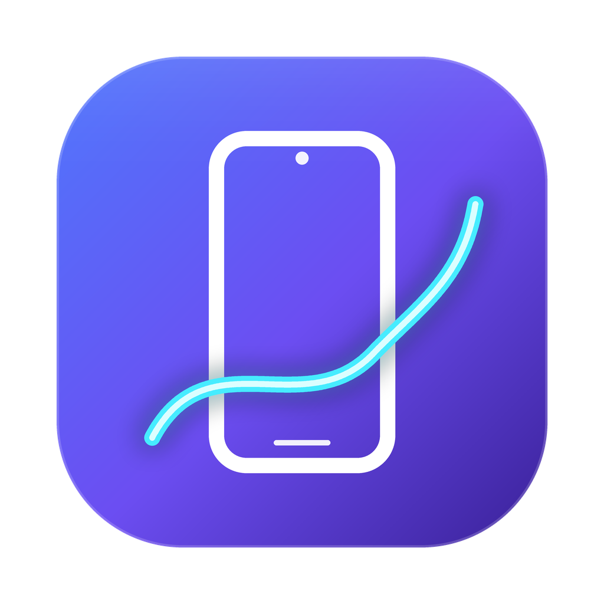
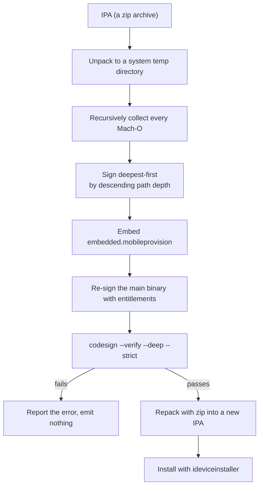

<div align="center">



# IPASigner

**The IPA re-signing and install machine** — pick an IPA → pick a device → pick a signing account → re-sign and install on iPhone in one click

<p>
English · <a href="README.md">简体中文</a>
</p>

[](https://github.com/Echoxiawan/IPASigner/actions/workflows/build.yml)
[](https://github.com/Echoxiawan/IPASigner/releases)
[](https://www.apple.com/macos/)
[](https://www.swift.org/)
[](LICENSE)
[](https://github.com/Echoxiawan/IPASigner/stargazers)
[](https://github.com/Echoxiawan/IPASigner/issues)

</div>

---

IPASigner turns the manual chain — unpack → sign nested binaries inside-out → embed the provisioning profile → re-sign the main binary → verify → repack → install with `ideviceinstaller` — into a single window.

It reuses the development identities already in your Keychain: **no Apple ID login inside the app, no network access**, fully offline signing. It does not request certificates, register AppIDs, or enroll devices — leave that to Xcode automatic signing or [developer.apple.com](https://developer.apple.com). This tool only handles the last mile: *once your certificate and profile are ready, how do you get the package onto the phone fastest.*

> The app UI is currently in Simplified Chinese. This document uses the Chinese button labels with English explanations.

---

<a id="contents"></a>

## Contents

- [✨ Features](#features)
- [📦 Requirements](#requirements)
- [🚀 Quick Start](#quick-start)
- [📖 Usage](#usage)
- [⌨️ Command Line Mode](#cli)
- [🔐 How Signing Works](#how-signing-works)
- [🗂️ Project Layout](#layout)
- [❓ FAQ](#faq)
- [🔒 Security and Scope](#security)
- [🤝 Contributing](#contributing)
- [📄 License](#license)

---

<a id="features"></a>

## ✨ Features

| Capability | Details |
|---|---|
| Read IPA | Reads `Payload/*.app/Info.plist` without a full unpack: bundle id, name, version, minimum iOS, executable name |
| Device discovery | Live USB detection via `idevice_id` / `ideviceinfo`, with name, model, iOS version and full UDID |
| Account pairing | Keychain certificates × local profiles matched automatically; only combos that can sign *this app for this device* are listed |
| Re-signing | Nested binaries signed deepest-first; frameworks / appex bundles folded into single signing targets; entitlements rebuilt from the profile |
| Verification | Fails on `codesign --verify --deep --strict`; never emits a broken IPA |
| Installation | `ideviceinstaller` with live progress; optional auto-launch after install |
| Export | "Sign only, export…" writes the signed IPA anywhere you choose |
| Traceable | Step-by-step `①`–`⑩` logs show exactly where a run stopped |
| Two front ends | The same engine powers both the SwiftUI window and a CLI mode |

---

<a id="requirements"></a>

## 📦 Requirements

### System and tools

| Dependency | Purpose | Minimum |
|---|---|---|
| macOS | Runtime | 13.0 (Ventura), Apple Silicon or Intel |
| Xcode or Command Line Tools | Provides `swiftc`, `codesign`, `security`, `zip`, `unzip` | Xcode 14 (Swift 5.7) |
| libimobiledevice | Device communication: `idevice_id` / `ideviceinfo` / `ideviceinstaller` | Any recent version |

```bash
brew install libimobiledevice      # the device communication trio
```

The `openssl` binary bundled with macOS is used to read the team ID (the `OU` field) from certificates — nothing extra to install.

Optional: auto-launch after install relies on `pymobiledevice3` (silently skipped when absent; installation still succeeds):

```bash
pip3 install pymobiledevice3
```

### Signing prerequisites

Missing any one of these is the usual reason for "no usable account":

1. You have signed in to the Apple ID you want to use under **Xcode → Settings → Accounts**;
2. The target device has been **connected to Xcode once**, so a profile containing its UDID exists;
3. **Settings → Privacy & Security → Developer Mode** is enabled on the device (required on iOS 16+, otherwise the app installs but crashes on launch);
4. The device is unlocked and you tapped "Trust This Computer" at install time.

---

<a id="quick-start"></a>

## 🚀 Quick Start

### Use a prebuilt release

1. Download `IPASigner-<version>-macOS.zip` from [Releases](https://github.com/Echoxiawan/IPASigner/releases) and unzip it;
2. Drag `IPASigner.app` into /Applications;
3. If Gatekeeper blocks the first launch, right-click → Open, or run:

```bash
xattr -dr com.apple.quarantine /Applications/IPASigner.app
```

Release builds are **ad-hoc signed and not notarized**, so that one-time confirmation is required; the source is fully reviewable.

### Build from source

```bash
./build.sh                    # host architecture, default version 1.0.0
open build/IPASigner.app

VERSION=1.2.0 ./build.sh      # version goes into Info.plist and the zip name
UNIVERSAL=1 ./build.sh        # arm64 + x86_64 universal binary (via lipo)
```

The build script does exactly four things:

1. `swiftc -O` compiles `Sources/*.swift` into an executable;
2. wraps it with `Resources/Info.plist` and the icon;
3. signs it ad-hoc with `codesign -` and verifies the result;
4. packages `dist/IPASigner-<version>-macOS.zip` with `ditto`.

Artifacts:

```text
build/IPASigner.app               double-click and run
dist/IPASigner-<version>-macOS.zip   distributable package
```

Only the host architecture is built by default; `UNIVERSAL=1` produces both `arm64` and `x86_64`.

### Three steps to a signed app

1. **① Choose the IPA** — click "浏览…" (Browse…) and pick an `.ipa`; the panel below shows its name, version, bundle id and minimum iOS;
2. **② Choose the device** — the dropdown lists connected and trusted devices; the full UDID appears underneath;
3. **③ Choose a signing account** — a pre-matched "certificate → profile" pair, wildcard profiles first, with team, AppID and expiry in the details.

Then click **签名并安装** (Sign and Install) to push it straight to the phone, or **只签名导出…** (Sign only, export…) to just produce the IPA file.

The status bar at the bottom of the window turns into a line like this, meaning the environment is ready:

```text
证书 5 张 · 描述文件 23 个 · 设备 1 台
```

---

<a id="usage"></a>

## 📖 Usage

Top to bottom the window is three selections plus one action button:

- **Package info** — name, version, bundle id and minimum iOS of the selected IPA;
- **Device dropdown** — connected and trusted devices; the full UDID is shown below it;
- **Account dropdown** — only the "certificate + profile" combinations that actually work;
- **"装完自动启动" (auto-launch after install) checkbox** — tries to start the app once installation finishes (requires `pymobiledevice3` and an unlocked device; failure does not affect the install).

### Logs

The log area prints each step in order, so you can see exactly where a run stopped:

```text
① 解包 xxx.ipa → 临时目录
② 权限: application-identifier = TEAM.bundle.id，get-task-allow = true
③ 需要签名的二进制共 N 个（含主程序）
④ 已嵌入描述文件: ...
⑤ 主程序已签名，身份: Apple Development: ...
⑥ 自检通过: valid on disk / satisfies its Designated Requirement
⑦ 输出: /path/xxx-signed.ipa
⑧ 开始安装 → 设备 UDID
⑨ 安装完成
⑩ 启动 com.example.app …
```

> Exporting also requires a selected device: candidate accounts are filtered by certificate + profile + device UDID + bundle id.

---

<a id="cli"></a>

## ⌨️ Command Line Mode

GUI and CLI share the same discovery, matching, signing and installation logic, which makes the CLI convenient for scripting and troubleshooting. Call the executable inside the built app directly:

```bash
APP=build/IPASigner.app/Contents/MacOS/IPASigner

$APP --list          # list certificates / profiles / devices
$APP --help-cli      # show usage
```

<details>
<summary>📌 Click to expand the full CLI usage</summary>

```bash
$APP --sign --ipa ~/Downloads/App.ipa \
     --device <UDID> \
     --out ~/Downloads/App-signed.ipa \
     [--identity <cert SHA1>] [--profile <profile path>] \
     [--install] [--launch]
```

</details>

All parameters:

| Parameter | Type | Default | Description |
|---|---|---|---|
| `--ipa <path>` | path | — | Input IPA; required with `--sign` |
| `--device <UDID>` | string | — | Target device; decides whether the profile must contain that UDID. Required |
| `--identity <SHA1>` | string | auto-matched | Certificate fingerprint (40 uppercase hex chars) |
| `--profile <path>` | path | auto-matched | Provisioning profile; works even outside the default directories |
| `--out <path>` | path | `<name>-signed.ipa` | Output IPA path |
| `--install` | flag | off | Install onto `--device` right after signing |
| `--launch` | flag | off | Launch the app after installing; requires `--install` |

Actual `--list` output looks like this:

```text
== 签名证书 (2) ==
  4E1D9C7B2A5F6083D4B1E9C7A2F5D6083D4B1E9C  Apple Development: Zhang San (ABCDE12345)  团队 9M49ULVKP2
== 描述文件 (23) ==
  有效  9M49ULVKP2.*  2027-10-06  设备 77  iOS Team Provisioning Profile: *
== 连接设备 (1) ==
  b0975756d2a1c4e5f8091a2b3c4d5e6f7a8b9c0d  iPhone  |  iPhone10,3  |  iOS 16.7.16
```

---

<a id="how-signing-works"></a>

## 🔐 How Signing Works



Concretely, it does the following:

1. **Unpack**: an IPA is a zip; extract it into a system temp directory.
2. **Collect Mach-O binaries**: recursively scan every executable in the bundle (including dylibs nested inside frameworks); `*.framework` / `*.appex` / `*.bundle` / `*.xpc` are folded into "sign the whole directory", so a later step cannot overwrite the inner signature.
3. **Sign deepest-first**: order targets by descending path depth — innermost dylib first, then frameworks, then the main binary. Getting this order wrong yields "the signing command succeeded but verification failed".
4. **Rebuild entitlements**: the profile grants permissions per team, so concrete values are substituted at signing time:

   ```xml
   application-identifier                = TEAMID.<bundleid>   <!-- wildcard * becomes the concrete bundle id -->
   com.apple.developer.team-identifier   = TEAMID
   get-task-allow                        = the value in the profile
   keychain-access-groups                = wildcard groups become the concrete AppID, the rest unchanged
   ```

5. **Embed the profile first**: copy the `.mobileprovision` to `Payload/Xxx.app/embedded.mobileprovision` and only **then** sign the main binary. In the reverse order the profile never lands in `CodeResources`, and `--deep --strict` reports `a sealed resource is missing or invalid`.
6. **Re-sign the main binary**: sign it once more with entitlements, then run `codesign --verify --deep --strict` and abort immediately if it fails.
7. **Pack with zip, not ditto**: ditto drags in `._*` resource-fork files, and the device reports `Failed to create CFBundle from Payload/._Xxx.app`.
8. **Install**: `ideviceinstaller -u <UDID> -i <ipa>`, with progress streamed back live.

The temp directory is removed when the run ends; the finished IPA is written only to the path you specify.

### How Accounts Are Matched

The tool never lets you pick blindly — it lists only the combinations that satisfy every one of these conditions:

| Condition | Why |
|---|---|
| Profile is not expired | An expired profile signs fine but never installs |
| Profile team == certificate team | Cross-team signing always fails verification |
| The profile's embedded certificate list contains this certificate | The device validates against the certificate list in the profile |
| The AppID covers the bundle id | `TEAM.*` is wildcard and signs anything; `TEAM.com.foo` only signs that exact id |
| `ProvisionedDevices` contains the selected device | Development profiles must list the device UDID |

Ordering: wildcard profiles first, then by latest expiry. In practice the first entry is the one you want.

Certificates come from the system Keychain (`security find-identity -v -p codesigning`), listing only identities usable for code signing; the team ID is read from the certificate subject's `OU` field.

---

<a id="layout"></a>

## 🗂️ Project Layout

```text
IPASigner/
├── Sources/
│   ├── App.swift          @main entry point (also dispatches to CLI mode)
│   ├── ContentView.swift  SwiftUI interface
│   ├── AppModel.swift     UI state and background task orchestration
│   ├── Models.swift       Certificates / profiles / devices / IPA / account candidates
│   ├── Discovery.swift    Discovery and matching of certs, profiles, devices, IPAs
│   ├── Signer.swift       Unpack → sign → embed profile → re-sign → verify → repack
│   ├── Installer.swift    Installation via ideviceinstaller and optional launch
│   ├── Snapshot.swift     Window self-snapshot
│   ├── CLIMode.swift      Command line entry point
│   └── Support.swift      Process execution / hashing / Mach-O detection / misc
├── Resources/             Info.plist and icon resources
├── docs/                  logo.png
├── build.sh               One-shot build of the .app
└── LICENSE
```

`Signer.swift` is the core — every signing detail lives there. `Discovery.swift` handles discovery and matching of certificates, profiles, devices and IPAs, and both the window and the CLI share that logic.

---

<a id="faq"></a>

## ❓ FAQ

| Symptom | Cause | Fix |
|---|---|---|
| "No matching account" | The profile does not contain the device UDID / is expired / its AppID does not cover this bundle | Generate a fresh profile for that device in Xcode |
| Team shows as `-` | Parsing the certificate subject failed | LibreSSL and OpenSSL 3 are both handled; use CLI `--list` for verbose output |
| `a sealed resource is missing or invalid: file added: embedded.mobileprovision` | The profile was embedded at the wrong moment | The profile must be embedded before the main binary is signed (this tool guarantees it) |
| `Failed to create CFBundle from .../._xxx.app` | Packaging pulled in resource-fork files | Pack with `zip` (this tool guarantees it); never use `ditto` when packaging by hand |
| Installs but crashes on launch | Developer Mode is off, or the profile expired | Enable Developer Mode and restart; free accounts expire after 7 days, so re-sign |
| No device in the list | Not unlocked / not trusted / libimobiledevice not installed | Unlock and tap Trust, then `brew install libimobiledevice` |
| "Cannot verify developer" on first launch | Release builds are not notarized | Right-click → Open, or run the `xattr` command above |
| CLI says "must pass --device" | Profile matching depends on the device UDID | Look up the UDID with `--list` and pass it |
| "No `Payload/*.app/Info.plist` found" | Not a standard IPA layout | Make sure it is a complete IPA, not a descriptor or a patch |

<details>
<summary>📌 Click to expand: auto-launch after install does not work</summary>

This feature is an optional enhancement — failure never affects the installation result. The log tells you exactly why:

- `（跳过启动：未安装 pymobiledevice3）` — install it with `pip3 install pymobiledevice3`;
- `（跳过启动：没有 python3）` — install Python 3;
- `（没拉起来：设备要解锁，开发者磁盘镜像要挂上）` — unlock the iPhone and retry, or just tap the icon to open the app yourself.

</details>

---

<a id="security"></a>

## 🔒 Security and Scope

- **Fully local**: the app never signs in to an Apple ID, makes no network requests and writes no database; certificates and private keys stay in the system Keychain.
- **Minimal writes**: unpacking and signing happen in a system temp directory that is cleaned up afterwards; the finished IPA is written only to the path you specify.
- **Equivalent to a normal install**: it uses your own developer certificate, so the resulting app behaves like one built and installed by Xcode.
- **Scope**: this tool only covers "how to sign and install fast once the certificate and profile are ready". Requesting certificates, registering AppIDs and enrolling devices belong in Xcode automatic signing or [developer.apple.com](https://developer.apple.com).
- **Not intended for**: re-signing and redistributing App Store apps, jailbroken devices, or large-scale enterprise distribution.

---

<a id="contributing"></a>

## 🤝 Contributing

Issues are welcome, and so are pull requests:

1. Fork the repo and create a branch (`feature/xxx` or `fix/xxx`);
2. Run `./build.sh` and `UNIVERSAL=1 ./build.sh` locally to confirm the universal binary still builds;
3. Open the PR — CI builds and smoke tests it automatically;
4. Releases are cut by the maintainer by pushing a `v*` tag.

If your change touches the signing logic, please explain in the PR description **why it must be done that way** — the ordering of the signing steps carries hard constraints, and getting it wrong compiles fine but fails on the device.

---

<a id="license"></a>

## 📄 License

This project is open source under the [MIT](./LICENSE) license.

Signing and installation invoke system and third-party tools such as `codesign`, `security` and `ideviceinstaller`; this repository ships only the calling logic and distributes no Apple certificates or provisioning profiles.
