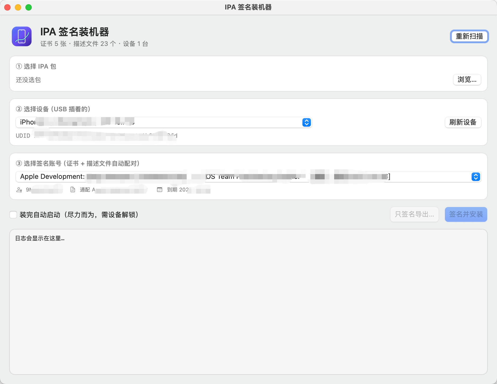
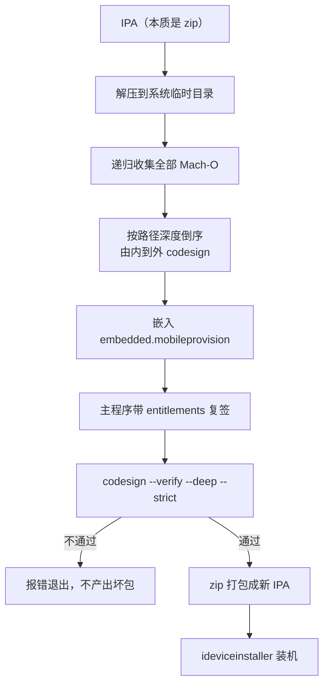

<div align="center">


# IPASigner

**IPA 签名装机器** —— 选 IPA → 选设备 → 选签名账号 → 一键重签名并装进 iPhone

<p>
<a href="README.en.md">English</a> · 简体中文
</p>

[](https://github.com/Echoxiawan/IPASigner/actions/workflows/build.yml)
[](https://github.com/Echoxiawan/IPASigner/releases)
[](https://www.apple.com/macos/)
[](https://www.swift.org/)
[](LICENSE)
[](https://github.com/Echoxiawan/IPASigner/stargazers)
[](https://github.com/Echoxiawan/IPASigner/issues)

</div>

---

把「解包 → 由内到外 codesign → 嵌描述文件 → 复签主程序 → 自检 → 打包 → ideviceinstaller 装机」这串手工活收进一个窗口。

直接使用钥匙串里现成的开发者证书：**不在工具里登录 Apple ID，也不联网**，全程本地离线签名。它不申请证书、不注册 AppID、不登记设备——那些照旧交给 Xcode 自动签名或 [developer.apple.com](https://developer.apple.com)；本工具只负责「证书和描述文件已就绪时，怎么最快把包装到手机上」。

<div align="center">

</div>

---

<a id="contents"></a>

## 目录

- [✨ 功能特性](#features)
- [📦 环境要求](#requirements)
- [🚀 快速开始](#quick-start)
- [📖 使用](#usage)
- [⌨️ 命令行模式](#cli)
- [🔐 签名原理](#how-signing-works)
- [🗂️ 项目结构](#layout)
- [❓ 常见问题](#faq)
- [🔒 安全与边界](#security)
- [🤝 贡献](#contributing)
- [📄 许可证](#license)

---

<a id="features"></a>

## ✨ 功能特性

| 能力 | 说明 |
|---|---|
| 读包 | 不完整解包，直接读 `Payload/*.app/Info.plist`：bundle id、名称、版本、最低 iOS、可执行文件名 |
| 选设备 | 通过 `idevice_id` / `ideviceinfo` 实时探测 USB 设备，显示名称、机型、iOS 版本和完整 UDID |
| 选账号 | 钥匙串证书 × 本机描述文件自动配对，只列出真正能给「这台设备 + 这个包」签名的组合 |
| 重签名 | 嵌套二进制由深到浅签名，framework / appex 折叠成整目录，entitlements 按描述文件还原 |
| 自检 | `codesign --verify --deep --strict` 不通过就报错，绝不产出坏包 |
| 装机 | `ideviceinstaller` 实时进度；可选装完自动拉起 App |
| 导出 | 「只签名导出…」把成品 IPA 存到任意位置 |
| 可追踪 | 全程 `①`–`⑩` 分步日志，卡在哪一步一眼可见 |
| 双入口 | 同一套引擎同时提供 SwiftUI 窗口和命令行模式 |

---

<a id="requirements"></a>

## 📦 环境要求

### 系统与工具

| 依赖 | 用途 | 最低版本 |
|---|---|---|
| macOS | 运行环境 | 13.0（Ventura），Apple Silicon / Intel 均可 |
| Xcode 或 Command Line Tools | 提供 `swiftc`、`codesign`、`security`、`zip`、`unzip` | Xcode 14（Swift 5.7） |
| libimobiledevice | 设备通讯：`idevice_id` / `ideviceinfo` / `ideviceinstaller` | 任意近期版本 |

```bash
brew install libimobiledevice      # 设备通讯三件套
```

macOS 自带的 `openssl` 用于解析证书的团队 ID（`OU` 字段），无需额外安装。

可选：装完自动启动功能依赖 `pymobiledevice3`（没有就静默跳过，不影响安装）：

```bash
pip3 install pymobiledevice3
```

### 签名前置条件

缺任何一项，都可能出现「没有可用的账号」：

1. 在 **Xcode → Settings → Accounts** 里登录过要用的 Apple ID；
2. 目标设备 **连过一次 Xcode**，以便生成包含该设备 UDID 的描述文件；
3. 设备打开 **设置 → 隐私与安全性 → 开发者模式**（iOS 16+ 必开，否则装得上但点开闪退）；
4. 安装时设备已解锁并点了「信任此电脑」。

---

<a id="quick-start"></a>

## 🚀 快速开始

### 用预编译版本

1. 在 [Releases](https://github.com/Echoxiawan/IPASigner/releases) 下载 `IPASigner-<版本>-macOS.dmg`，打开后把 `IPASigner.app` 拖进「应用程序」（也可以下载 zip 解压后手动拖入）；
2. 首次打开若被 Gatekeeper 拦截，右键 → 打开，或执行：

```bash
xattr -dr com.apple.quarantine /Applications/IPASigner.app
```

发布包是 **ad-hoc 签名、未公证** 的，所以第一次需要上述确认；源码可以完整审阅。

### 从源码构建

```bash
./build.sh                    # 本机架构，默认版本 1.0.0
open build/IPASigner.app

VERSION=1.2.0 ./build.sh      # 版本号写进 Info.plist 和 zip/dmg 文件名
UNIVERSAL=1 ./build.sh        # arm64 + x86_64 通用二进制（lipo 合并）
```

构建脚本只做五件事：

1. `swiftc -O` 把 `Sources/*.swift` 编成可执行文件；
2. 套上 `Resources/Info.plist` 与图标；
3. `codesign -` 本地 ad-hoc 签名并自检；
4. 用 `ditto` 打出 `dist/IPASigner-<版本>-macOS.zip`；
5. 用 `hdiutil` 打出 `dist/IPASigner-<版本>-macOS.dmg`（内含「应用程序」快捷方式，拖拽安装）。

产物：

```text
build/IPASigner.app               可直接双击运行
dist/IPASigner-<版本>-macOS.zip   可分发包
dist/IPASigner-<版本>-macOS.dmg   拖拽式安装盘
```

默认只编本机架构；`UNIVERSAL=1` 才同时包含 `arm64` 和 `x86_64`。

### 三步跑通

1. **① 选择 IPA 包** —— 点「浏览…」挑一个 `.ipa`，下方显示包名、版本、bundle id 和最低 iOS；
2. **② 选择设备** —— 下拉里是当前 USB 连接并已信任的设备，下方显示完整 UDID；
3. **③ 选择签名账号** —— 自动配对好的「证书 → 描述文件」，通配描述文件优先，详情显示团队、AppID、到期日。

然后点 **签名并安装**（直接装进手机）或 **只签名导出…**（只产出 IPA 文件）。

窗口底部状态栏会变成类似这样的一行，说明环境已就绪：

```text
证书 5 张 · 描述文件 23 个 · 设备 1 台
```

---

<a id="usage"></a>

## 📖 使用

窗口从上到下就是三步选择 + 一个动作按钮：

- **包信息区** —— 显示所选 IPA 的名称、版本、bundle id、最低 iOS；
- **设备下拉** —— 列出已连接并信任的设备，选中后显示完整 UDID；
- **账号下拉** —— 只列出真正可用的「证书 + 描述文件」组合；
- **「装完自动启动」勾选框** —— 安装完成后尝试拉起 App（依赖 `pymobiledevice3` 和设备解锁，失败不影响安装结果）。

### 日志

日志区按流程逐步输出，卡在哪一步一眼可见：

```text
① 解包 xxx.ipa → 临时目录
② 权限: application-identifier = TEAM.bundle.id，get-task-allow = true
③ 需要签名的二进制共 N 个（含主程序）
④ 已嵌入描述文件: ...
⑤ 主程序已签名，身份: Apple Development: ...
⑥ 自检通过: valid on disk / satisfies its Designated Requirement
⑦ 输出: /path/xxx-signed.ipa
⑧ 开始安装 → 设备 UDID
⑨ 安装完成
⑩ 启动 com.example.app …
```

> 导出同样需要选一台设备：候选账号是按「证书 + 描述文件 + 设备 UDID + bundle id」过滤出来的。

---

<a id="cli"></a>

## ⌨️ 命令行模式

GUI 和 CLI 共用同一套发现、匹配、签名、安装逻辑，适合脚本化或排错。构建后可直接调用 app 里的可执行文件：

```bash
APP=build/IPASigner.app/Contents/MacOS/IPASigner

$APP --list          # 列证书 / 描述文件 / 设备
$APP --help-cli      # 查看用法
```

<details>
<summary>📌 点击展开完整 CLI 用法</summary>

```bash
$APP --sign --ipa ~/Downloads/App.ipa \
     --device <UDID> \
     --out ~/Downloads/App-signed.ipa \
     [--identity <证书SHA1>] [--profile <描述文件路径>] \
     [--install] [--launch]
```

</details>

所有参数如下：

| 参数 | 类型 | 默认值 | 说明 |
|---|---|---|---|
| `--ipa <路径>` | 路径 | 无 | 输入 IPA，`--sign` 必填 |
| `--device <UDID>` | 字符串 | 无 | 目标设备；决定描述文件是否包含该 UDID，必填 |
| `--identity <SHA1>` | 字符串 | 自动匹配 | 指定证书指纹（40 位大写） |
| `--profile <路径>` | 路径 | 自动匹配 | 指定描述文件，不在默认目录时也能用 |
| `--out <路径>` | 路径 | `<原名>-signed.ipa` | 输出 IPA 路径 |
| `--install` | 开关 | 关 | 签完直接安装到 `--device` |
| `--launch` | 开关 | 关 | 装完拉起 App，需与 `--install` 同用 |

`--list` 的实际输出形如：

```text
== 签名证书 (2) ==
  4E1D9C7B2A5F6083D4B1E9C7A2F5D6083D4B1E9C  Apple Development: Zhang San (ABCDE12345)  团队 9M49ULVKP2
== 描述文件 (23) ==
  有效  9M49ULVKP2.*  2027-10-06  设备 77  iOS Team Provisioning Profile: *
== 连接设备 (1) ==
  b0975756d2a1c4e5f8091a2b3c4d5e6f7a8b9c0d  iPhone  |  iPhone10,3  |  iOS 16.7.16
```

---

<a id="how-signing-works"></a>

## 🔐 签名原理



具体做了哪几件事：

1. **解包**：IPA 本质是 zip，解到系统临时目录。
2. **收集 Mach-O**：递归扫描包内所有可执行文件（包括 framework 里嵌套的 dylib）；`*.framework` / `*.appex` / `*.bundle` / `*.xpc` 折叠成「签整个目录」，避免内层签名被后续操作冲掉。
3. **由深到浅签**：按路径深度倒序，先签最内层 dylib，再签框架，最后主程序。顺序错了会出现「签名命令成功但自检失败」。
4. **还原 entitlements**：描述文件里的权限是按团队授予的，签名时需要换成具体值：

   ```xml
   application-identifier                = TEAMID.<bundleid>   <!-- 通配 * 换成具体包名 -->
   com.apple.developer.team-identifier   = TEAMID
   get-task-allow                        = 描述文件里的值
   keychain-access-groups                = 通配组换成具体 AppID，其余原样
   ```

5. **先嵌描述文件**：把 `.mobileprovision` 复制为 `Payload/Xxx.app/embedded.mobileprovision`，**然后**才签主程序。顺序反了 profile 不会进 `CodeResources`，`--deep --strict` 会报 `a sealed resource is missing or invalid`。
6. **复签主程序**：主程序带 entitlements 再签一次，随后执行 `codesign --verify --deep --strict`，不通过立即报错退出。
7. **用 zip 而不是 ditto 打包**：ditto 会带入 `._*` 资源分叉文件，设备端会报 `Failed to create CFBundle from Payload/._Xxx.app`。
8. **装机**：`ideviceinstaller -u <UDID> -i <ipa>`，进度实时回显。

临时目录在流程结束后删除，成品 IPA 只写到指定路径。

### 账号是怎么配对的

工具不会让你盲目选择，只列出同时满足以下全部条件的组合：

| 条件 | 原因 |
|---|---|
| 描述文件未过期 | 过期签名即使成功也装不上 |
| 描述文件团队 == 证书团队 | 跨团队签名必然验签失败 |
| 描述文件内嵌证书列表包含该证书 | 设备会用 profile 里的证书列表校验 |
| AppID 覆盖包的 bundle id | `TEAM.*` 通配可签任意包；`TEAM.com.foo` 只能签同 ID 包 |
| `ProvisionedDevices` 包含所选设备 | 开发描述文件必须登记设备 UDID |

排序规则：通配描述文件优先，其次按到期日从晚到早。一般直接选第一项即可。

证书本身来自系统钥匙串（`security find-identity -v -p codesigning`），只列出可用于代码签名的条目；团队 ID 取证书 subject 的 `OU` 字段。

---

<a id="layout"></a>

## 🗂️ 项目结构

```text
IPASigner/
├── Sources/
│   ├── App.swift          @main 入口（同时负责 CLI 分流）
│   ├── ContentView.swift  SwiftUI 界面
│   ├── AppModel.swift     界面状态与后台任务编排
│   ├── Models.swift       证书 / 描述文件 / 设备 / IPA / 候选账号
│   ├── Discovery.swift    证书、描述文件、设备、IPA 的发现与匹配
│   ├── Signer.swift       解包 → 签名 → 嵌 profile → 复签 → 自检 → 打包
│   ├── Installer.swift    ideviceinstaller 装机与可选拉起
│   ├── Snapshot.swift     窗口自截图
│   ├── CLIMode.swift      命令行入口
│   └── Support.swift      进程执行 / 哈希 / Mach-O 判定 / 杂项
├── Resources/             Info.plist 与图标资源
├── docs/                  logo.png、screenshot.png
├── build.sh               一键构建 .app
└── LICENSE
```

`Signer.swift` 是核心，所有签名细节都在里面；`Discovery.swift` 负责证书、描述文件、设备和 IPA 的发现与匹配；窗口和命令行共用这一套逻辑。

---

<a id="faq"></a>

## ❓ 常见问题

| 现象 | 原因 | 处理 |
|---|---|---|
| 「没有匹配的账号」 | 描述文件不含该设备 UDID / 已过期 / AppID 覆盖不了这个包 | 在 Xcode 里为这台设备重新生成一次描述文件 |
| 团队显示为 `-` | 解析证书 subject 失败 | 已兼容 LibreSSL 与 OpenSSL 3；仍异常时用 CLI `--list` 查看详细输出 |
| `a sealed resource is missing or invalid: file added: embedded.mobileprovision` | 描述文件放入时机不对 | 必须先嵌 profile 再签主程序（本工具已保证） |
| `Failed to create CFBundle from .../._xxx.app` | 打包带入资源分叉文件 | 用 `zip` 打包（本工具已保证）；手工打包不要用 `ditto` |
| 装上但点开闪退 | 开发者模式未开启，或描述文件过期 | 开启开发者模式并重启；免费账号 7 天过期后重签 |
| 设备不在列表 | 未解锁 / 未信任 / 未安装 libimobiledevice | 解锁并点信任，`brew install libimobiledevice` |
| 首次打开提示「无法验证开发者」 | 发布包未公证 | 右键 → 打开，或执行上文 `xattr` 命令 |
| CLI 报「必须带 --device」 | 描述文件匹配依赖设备 UDID | 用 `--list` 查到 UDID 后带上 |
| 报「没找到 Payload/*.app/Info.plist」 | 不是标准 IPA 结构 | 确认是完整 IPA 而不是描述文件或补丁包 |

<details>
<summary>📌 点击展开「装完自动启动」用不了怎么办</summary>

这个功能是可选增强，失败不影响安装结果。日志会直接告诉你原因：

- `（跳过启动：未安装 pymobiledevice3）` —— 装上即可：`pip3 install pymobiledevice3`；
- `（跳过启动：没有 python3）` —— 安装 Python 3；
- `（没拉起来：设备要解锁，开发者磁盘镜像要挂上）` —— 解锁 iPhone 后重试，或直接点桌面图标手动打开。

</details>

---

<a id="security"></a>

## 🔒 安全与边界

- **纯本地**：工具内不登录 Apple ID、不发起网络请求、不写数据库；证书和私钥始终留在系统钥匙串。
- **最小写入**：解包和签名在系统临时目录完成，结束即清理；成品 IPA 只写到用户指定路径。
- **等效签名**：使用你自己的开发者证书，装出来的 App 与 Xcode 直接编译安装等效。
- **范围**：本工具只负责「证书和描述文件已就绪时，如何快速签名并安装」。申请证书、注册 AppID、登记设备请在 Xcode 自动签名或 [developer.apple.com](https://developer.apple.com) 完成。
- **不适用于**：App Store 已上架 App 的重签分发、越狱设备、批量分发的企业场景。

---

<a id="contributing"></a>

## 🤝 贡献

欢迎提 Issue 反馈问题，也欢迎直接提 PR：

1. Fork 本仓库并新建分支（`feature/xxx` 或 `fix/xxx`）；
2. 本地跑一遍 `./build.sh` 和 `UNIVERSAL=1 ./build.sh`，确认能编译出通用二进制；
3. 改完开 PR，CI 会自动编译并冒烟验证；
4. Release 由维护者推 `v*` tag 触发。

如果改动涉及签名逻辑，请在 PR 描述里说明**为什么必须这样改**——签名步骤的先后顺序是有强约束的，改错不会报编译错误，只会在设备上失败。

---

<a id="license"></a>

## 📄 许可证

本项目基于 [MIT](./LICENSE) 许可证开源。

签名与安装过程会调用 `codesign`、`security`、`ideviceinstaller` 等系统与第三方工具，本仓库只提供调用逻辑，不分发任何 Apple 证书或描述文件。
